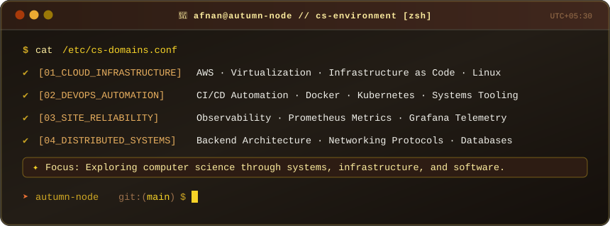

<!-- HERO BANNER -->

 

<!-- ANIMATED ROTATING DOMAINS -->

 

<!-- REFINED AUTUMN DOMAIN BADGES -->

  
  &nbsp;
  
  &nbsp;
  
  &nbsp;
  

<!-- BOTANICAL DIVIDER -->

## 🌲 INTRODUCTION

> *"Exploring computer science through cloud infrastructure, systems automation, and distributed architectures. Focused on building dependable software systems, designing reproducible infrastructure with code, and understanding the core mechanics of reliable platforms."*

<!-- AUTUMN TERMINAL: CS DOMAINS OVERVIEW -->

 

## 🧭 COMPUTER SCIENCE DOMAINS

A structured overview of core technical disciplines, architectural concepts, and engineering domains of interest.

<table>
  <tr>
    <td width="50%" valign="top">
      <h3>🍂 Cloud Computing &amp; Infrastructure</h3>
      

        Design and management of scalable cloud environments, virtualized resources, and declarative infrastructure topologies.
      

      <ul>
        <li><strong>Infrastructure as Code:</strong> Declarative topologies, state management, and resource provisioning</li>
        <li><strong>Cloud Topology:</strong> Virtual Private Clouds (VPC), subnet routing, gateways, and network isolation</li>
        <li><strong>High Availability:</strong> Multi-AZ deployment architectures and fault-isolated compute clusters</li>
        <li><strong>Systems Foundation:</strong> Linux operating system internals, permissions, and service management</li>
      </ul>
      

        
      

    </td>
    <td width="50%" valign="top">
      <h3>🍁 DevOps &amp; Systems Engineering</h3>
      

        Practices and tooling bridging software delivery with reproducible systems administration and automated workflows.
      

      <ul>
        <li><strong>Containerization:</strong> Docker images, container runtimes, and layered filesystem architectures</li>
        <li><strong>Orchestration:</strong> Kubernetes workload scheduling, deployments, services, and configuration</li>
        <li><strong>CI/CD Automation:</strong> Automated validation pipelines, GitHub Actions workflows, and build systems</li>
        <li><strong>Scripting &amp; Tooling:</strong> Shell scripting (Bash) and systems automation utilities in Python</li>
      </ul>
      

        
      

    </td>
  </tr>
  <tr>
    <td width="50%" valign="top">
      <h3>🌾 Site Reliability &amp; Observability</h3>
      

        Engineering principles ensuring systems remain observable, resilient under stress, and rapid to inspect during anomalies.
      

      <ul>
        <li><strong>Telemetry Collection:</strong> Time-series metric collection with Prometheus and system health exporters</li>
        <li><strong>Observability Dashboards:</strong> Telemetry visualization, threshold monitoring, and Grafana dashboards</li>
        <li><strong>Fault Tolerance:</strong> Failure domain segregation, graceful degradation, and health check probing</li>
        <li><strong>Operational Rigor:</strong> Incident analysis, toil reduction, and declarative remediation workflows</li>
      </ul>
      

        
      

    </td>
    <td width="50%" valign="top">
      <h3>🌰 Software Engineering &amp; Backend Systems</h3>
      

        Software design, service communication protocols, and data persistence layers across distributed environments.
      

      <ul>
        <li><strong>Backend Architecture:</strong> RESTful API design, asynchronous request processing, and modular structure</li>
        <li><strong>Data Persistence:</strong> Relational databases (PostgreSQL), in-memory caching (Redis), and schema design</li>
        <li><strong>Systems Programming:</strong> Object-oriented and functional patterns in Python, TypeScript, and Go</li>
        <li><strong>Networking Protocols:</strong> TCP/IP, HTTP/HTTPS, DNS resolution, and inter-service communication</li>
      </ul>
      

        
      

    </td>
  </tr>
</table>

  

## 🐍 THE FOREST FLOOR — CONTRIBUTION TRAIL

Public GitHub contribution activity rendered in the custom autumn palette (*Autumn Ivory, Pale Golden Cream, Sunlit Yellow, Harvest Gold, and Autumn Orange*).

<!-- AUTUMN CONTRIBUTION SNAKE ANIMATION -->

  🍁 Generated daily from GitHub contribution logs via <a href=".github/workflows/snake.yml">snake.yml</a> &bull; Autumn Fallback: <a href="assets/profile/contribution-snake-autumn.svg">Local Render</a>

 

<!-- RECENT CONTRIBUTION ACTIVITY FLOW -->

  

## 📊 GITHUB ACTIVITY & METRICS

Public repository statistics and language distribution configured with Autumn palette tokens (`#18130E`, `#F7D327`, `#FEED9F`, `#D0A823`, `#EB7134`).

<table border="0" cellspacing="0" cellpadding="0">
  <tr>
    <td valign="top" align="center">
      
    </td>
    <td valign="top" align="center">
      
    </td>
  </tr>
</table>

 

<!-- COMMIT STREAK STATS -->

  

## 📜 ENGINEERING PRINCIPLES

1. **Automation Over Repetitive Toil**  
   *If an operational task is performed repeatedly, encode it into declarative code or an automated pipeline.*

2. **Observability Precedes Guesswork**  
   *Ground troubleshooting in telemetry, metrics, and structured logs rather than speculative assumptions. Telemetry is ground truth.*

3. **Resilience at the Architectural Foundation**  
   *Failure-domain isolation, immutable deployment artifacts, and graceful degradation must be engineered at the foundation.*

4. **Declarative State & Reproducibility**  
   *Version-controlled infrastructure and declarative specifications eliminate configuration drift and ensure deterministic environments.*

5. **Simplicity Over Fragile Complexity**  
   *A reliable system is one whose boundaries, failure modes, and recovery mechanisms are comprehensible and verifiable.*

  

## 📬 CONNECT & RESOURCES

  
  &nbsp;
  
  &nbsp;
  

 

<!-- FOOTER BANNER -->

