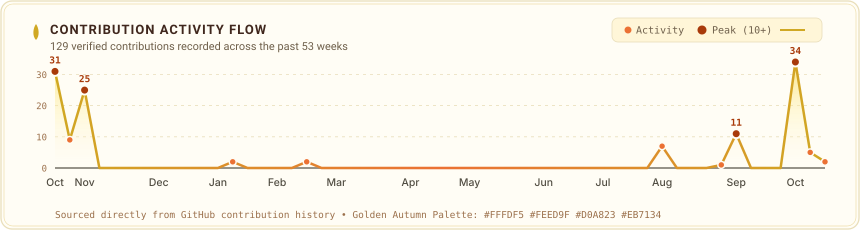

<!-- HERO BANNER (LIGHT GOLDEN SUNLIGHT THEME) -->

 

<!-- ANIMATED ROTATING DOMAINS (HIGH-CONTRAST LIGHT THEME) -->

 

<!-- LIGHT AUTUMN DOMAIN BADGES -->

  
  &nbsp;
  
  &nbsp;
  
  &nbsp;
  

<!-- BOTANICAL DIVIDER -->

## 🌲 INTRODUCTION

> *"Exploring computer science through cloud infrastructure, systems automation, backend engineering, and intelligent systems. Focused on building dependable software systems, designing reproducible infrastructure with code, and understanding the core mechanics of reliable platforms."*

<!-- AUTUMN TERMINAL: CS DOMAINS OVERVIEW (LIGHT THEME) -->

 

## 🧭 COMPUTER SCIENCE DOMAINS

A structured overview of core technical disciplines, architectural concepts, and engineering domains informed by academic foundation and software engineering practice.

### Primary Technical Domains

<table>
  <tr>
    <td width="50%" valign="top">
      <h3>🍂 Cloud Computing &amp; Infrastructure</h3>
      

        Design and management of scalable cloud environments, virtualized resources, and declarative infrastructure automation.
      

      <ul>
        <li><strong>Infrastructure as Code:</strong> Declarative topologies, state management, and resource provisioning with Terraform</li>
        <li><strong>Cloud Topology:</strong> Virtual Private Clouds (VPC), subnet routing, gateways, and network isolation</li>
        <li><strong>High Availability:</strong> Multi-AZ deployment architectures and fault-isolated compute resources</li>
        <li><strong>Systems Foundation:</strong> Linux operating system administration, permissions, and service management</li>
      </ul>
      

        
      

    </td>
    <td width="50%" valign="top">
      <h3>🍁 DevOps &amp; Systems Engineering</h3>
      

        Practices and tooling bridging software delivery with reproducible systems administration and automated workflows.
      

      <ul>
        <li><strong>Containerization:</strong> Docker images, container runtimes, multi-stage builds, and layered filesystems</li>
        <li><strong>Orchestration:</strong> Kubernetes workload scheduling, deployments, services, and cluster configuration</li>
        <li><strong>CI/CD Automation:</strong> Automated validation pipelines, GitHub Actions workflows, and build systems</li>
        <li><strong>Scripting &amp; Tooling:</strong> Shell scripting (Bash) and systems automation utilities in Python</li>
      </ul>
      

        
      

    </td>
  </tr>
  <tr>
    <td width="50%" valign="top">
      <h3>🤖 Artificial Intelligence &amp; Machine Learning</h3>
      

        Applied machine learning, language models, document intelligence, and neural transformer integrations.
      

      <ul>
        <li><strong>Language Model Integration:</strong> Orchestrating LLMs via LangChain, LangGraph, and Google Gemini API</li>
        <li><strong>Document Intelligence:</strong> Optical Character Recognition (OCR), Tesseract OCR, and structured data extraction</li>
        <li><strong>Natural Language Processing:</strong> Semantic text processing, sentiment analysis, and tokenization pipelines</li>
        <li><strong>Model Ecosystem:</strong> Hugging Face Transformers, prompt engineering, and intelligent recommendation logic</li>
      </ul>
      

        
      

    </td>
    <td width="50%" valign="top">
      <h3>🌰 Backend &amp; API Engineering</h3>
      

        Robust backend services, asynchronous request processing, authentication protocols, and API architecture.
      

      <ul>
        <li><strong>Modern Web Frameworks:</strong> High-performance asynchronous API services with FastAPI and Flask</li>
        <li><strong>Authentication &amp; Authorization:</strong> Secure token-based authentication with JWT and role permissions</li>
        <li><strong>API Design &amp; Standards:</strong> RESTful resource modeling, request validation, and comprehensive error handling</li>
        <li><strong>Data Validation &amp; Schemas:</strong> Structured data modeling, type enforcement, and serialization protocols</li>
      </ul>
      

        
      

    </td>
  </tr>
  <tr>
    <td width="50%" valign="top">
      <h3>🌾 Site Reliability &amp; Observability</h3>
      

        Engineering principles ensuring systems remain observable, resilient under stress, and rapid to inspect during anomalies.
      

      <ul>
        <li><strong>Telemetry Collection:</strong> Time-series metric collection with Prometheus and system health exporters</li>
        <li><strong>Observability Dashboards:</strong> Telemetry visualization, threshold monitoring, and Grafana dashboards</li>
        <li><strong>Fault Tolerance:</strong> Failure domain segregation, graceful degradation, and health check probing</li>
        <li><strong>Operational Rigor:</strong> Incident analysis, toil reduction, and declarative remediation workflows</li>
      </ul>
      

        
      

    </td>
    <td width="50%" valign="top">
      <h3>🧭 Networking &amp; Distributed Systems</h3>
      

        Computer networking fundamentals, inter-service transport protocols, and distributed systems architecture.
      

      <ul>
        <li><strong>Network Protocols:</strong> TCP/IP stack mechanics, HTTP/HTTPS lifecycle, DNS resolution, and routing</li>
        <li><strong>Virtual Networks:</strong> Subnetting, security group enforcement, network access control lists, and SSH tunnels</li>
        <li><strong>Distributed Communication:</strong> Asynchronous message passing, socket communication, and service discovery</li>
        <li><strong>Reliability &amp; Latency:</strong> Connection pooling, keep-alive mechanisms, and traffic distribution</li>
      </ul>
      

        
      

    </td>
  </tr>
</table>

### Specialized Disciplines &amp; Engineering Areas

<table>
  <tr>
    <td width="50%" valign="top">
      <h3>⚡ AI Agents &amp; Tool Integration</h3>
      

        Autonomous agent architectures, external tool execution, and structured agentic workflow orchestration.
      

      <ul>
        <li><strong>Agent Workflows:</strong> Multi-agent state machines and graph-based execution flows using LangGraph</li>
        <li><strong>Tool Execution:</strong> Dynamic function calling, tool registration, and parameter validation</li>
        <li><strong>Model Context Protocol:</strong> Standardized agent-to-tool communication using FastMCP</li>
        <li><strong>Automated Operations:</strong> Natural-language-driven automation for compliance and system audits</li>
      </ul>
    </td>
    <td width="50%" valign="top">
      <h3>📊 Data Engineering &amp; Analytics</h3>
      

        Analytical data pipelines, numerical transformations, and interactive statistical visualization dashboards.
      

      <ul>
        <li><strong>Data Manipulation:</strong> Large-scale tabular operations and dataset transformations using Pandas and NumPy</li>
        <li><strong>Interactive Dashboards:</strong> Production analytics web interfaces using Streamlit and Plotly</li>
        <li><strong>Statistical Analysis:</strong> Comparative pre/post performance evaluation and trend modeling</li>
        <li><strong>Automated Reporting:</strong> Automated metric extraction and formatted report generation</li>
      </ul>
      

        
      

    </td>
  </tr>
  <tr>
    <td width="50%" valign="top">
      <h3>🗄️ Databases &amp; Data Management</h3>
      

        Document stores, relational databases, data access layers, and caching mechanics.
      

      <ul>
        <li><strong>NoSQL Document Stores:</strong> Schema design, indexing, and aggregation pipelines with MongoDB</li>
        <li><strong>Relational Persistence:</strong> Relational schema design, normalization, and ACID transactions</li>
        <li><strong>In-Memory Caching:</strong> Fast key-value storage, session persistence, and cache eviction patterns</li>
        <li><strong>Data Integrity:</strong> Cryptographic hashing (SHA-256) for audit trails and change verification</li>
      </ul>
      

        
      

    </td>
    <td width="50%" valign="top">
      <h3>🔒 Security &amp; Privacy Engineering</h3>
      

        Data privacy compliance workflows, credential protection, and defense-in-depth security principles.
      

      <ul>
        <li><strong>Access Control:</strong> JSON Web Tokens (JWT), OAuth authentication, and principle of least privilege</li>
        <li><strong>Privacy Engineering:</strong> Sensitive data discovery (PII/PHI scanning) and regulatory policy enforcement</li>
        <li><strong>Audit Logging:</strong> Cryptographically verifiable audit logging for system actions and data access</li>
        <li><strong>Application Hardening:</strong> Input sanitization, CORS policy configuration, and container isolation</li>
      </ul>
    </td>
  </tr>
  <tr>
    <td width="50%" valign="top">
      <h3>📱 Software &amp; Mobile Development</h3>
      

        Cross-platform mobile interfaces, component-driven web frameworks, and native system languages.
      

      <ul>
        <li><strong>Mobile Engineering:</strong> Cross-platform mobile applications using Flutter and Dart</li>
        <li><strong>Frontend Frameworks:</strong> Component-driven responsive user interfaces with React and TypeScript</li>
        <li><strong>Core Systems Languages:</strong> Systems programming and algorithms in C, Java, and Python</li>
        <li><strong>Responsive Interfaces:</strong> Mobile-first UI layouts, asynchronous state management, and real-time views</li>
      </ul>
      

        
      

    </td>
    <td width="50%" valign="top">
      <h3>⚙️ Systems, Storage &amp; Virtualization</h3>
      

        Operating system internals, virtualization boundaries, and storage layer concepts.
      

      <ul>
        <li><strong>Linux Administration:</strong> Package managers, process monitoring, systemd units, and bash scripting</li>
        <li><strong>Server Health:</strong> CPU, memory, and disk I/O monitoring via Linux kernel telemetry</li>
        <li><strong>Virtualization:</strong> Hypervisor concepts, kernel namespaces, cgroups, and container virtualization</li>
        <li><strong>Storage Concepts:</strong> Block storage, object storage, backup retention, and disaster recovery principles</li>
      </ul>
      

        
      

    </td>
  </tr>
</table>

  

## 🐍 THE FOREST FLOOR — CONTRIBUTION TRAIL

Public GitHub contribution activity rendered in the warm, light autumn palette (*Autumn Ivory, Pale Golden Cream, Sunlit Yellow, Harvest Gold, and Burnt Sienna*).

<!-- AUTUMN CONTRIBUTION SNAKE ANIMATION (LIGHT PALETTE) -->

  🍁 Generated daily from GitHub contribution logs via <a href=".github/workflows/snake.yml">snake.yml</a> &bull; Autumn Light Fallback: <a href="assets/profile/contribution-snake-autumn.svg">Local Render</a>

 

<!-- REPAIRED CONTRIBUTION ACTIVITY GRAPH (LIGHT SUNLIT PALETTE) -->

  

## 📊 GITHUB ACTIVITY &amp; METRICS

Public repository statistics and language distribution configured with Light Autumn palette tokens (`#FFFDF5`, `#40271D`, `#54280D`, `#D0A823`, `#E8DDB9`).

<table border="0" cellspacing="0" cellpadding="0">
  <tr>
    <td valign="top" align="center">
      
    </td>
    <td valign="top" align="center">
      
    </td>
  </tr>
</table>

 

<!-- REPAIRED CONTRIBUTION STREAK STATS (HIGH CONTRAST ON LIGHT CARD) -->

  

## 📜 ENGINEERING PRINCIPLES

1. **Automation Over Repetitive Toil**  
   *If an operational task is performed repeatedly, encode it into declarative code or an automated pipeline.*

2. **Observability Precedes Guesswork**  
   *Ground troubleshooting in telemetry, metrics, and structured logs rather than speculative assumptions. Telemetry is ground truth.*

3. **Resilience at the Architectural Foundation**  
   *Failure-domain isolation, immutable deployment artifacts, and graceful degradation must be engineered at the foundation.*

4. **Declarative State &amp; Reproducibility**  
   *Version-controlled infrastructure and declarative specifications eliminate configuration drift and ensure deterministic environments.*

5. **Simplicity Over Fragile Complexity**  
   *A reliable system is one whose boundaries, failure modes, and recovery mechanisms are comprehensible and verifiable.*

  

## 📬 CONNECT &amp; RESOURCES

  
  &nbsp;
  
  &nbsp;
  
  &nbsp;
  

 

<!-- FOOTER BANNER (LIGHT THEME) -->

